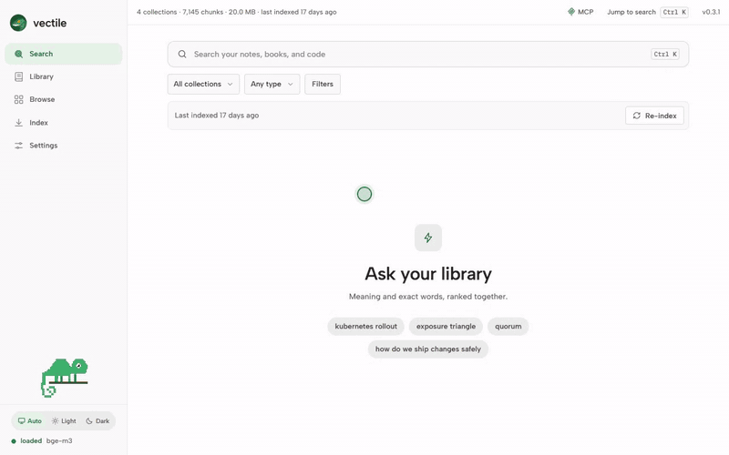
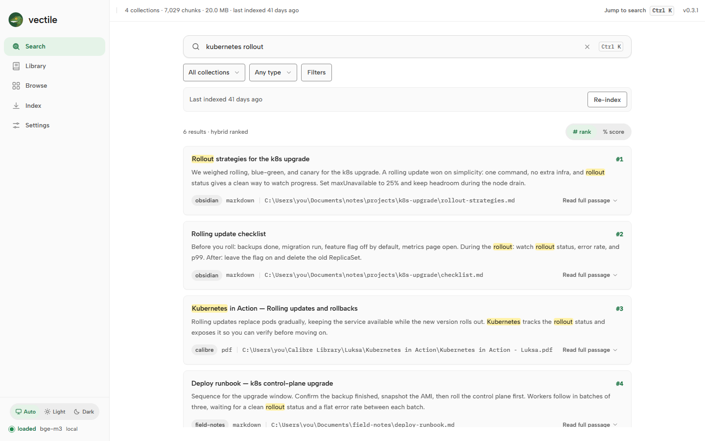

# vectile: your private library

A local RAG (Retrieval Augmented Generation) app for Windows, macOS, and Linux. It indexes your notes, books, and code into one SQLite database with hybrid vector + full-text search (Reciprocal Rank Fusion), so you can find things by meaning, not just exact words. Keyboard-first, and everything runs on your machine.

Inspired by Sebastian Hutter’s local-rag. No Ollama, no API keys: the embedding model runs in-process from a `.gguf` file you import or download from the built-in catalog.

  

  

## Features

- **Private by default:** searches run against a model loaded inside the app. Nothing leaves your machine.
- **Search by meaning:** two searches run at once and their results are combined, so a note on blue-green deploys matches “how do we ship changes safely” without ever using those words.
- **Index what you already have:** Obsidian vaults, folders of documents (Markdown, PDF, DOCX, HTML, TXT, CSV, JSON, YAML, XML, SQL, shell scripts, XLSX, PPTX, Jupyter notebooks, EPUB), Calibre libraries, and code repositories including commit history.
- **Bring your own model:** import a `.gguf`, pick the active model, or download one from the catalog in Settings.
- **Read scanned PDFs (optional):** one click in Settings installs a Tesseract OCR plugin, and PDFs that are photos of pages become searchable.
- **Manage your library:** open a collection to see its files, page through chunks, and delete a source, selected chunks, or a whole library.
- **Reach it from an AI assistant (MCP):** offer search, read, and collection tools to Claude Desktop or any MCP client over a local server.

## Download

Pick your platform:

 - ⚠️ SmartScreen will block it · [how to fix](#first-run-notes) 
 
 
 

> Windows 10/11 · Linux (AppImage + deb) · macOS (universal arm64 + amd64) · **app is not code-signed, [see first-run notes below](#first-run-notes)**

Normal Windows builds need a CPU feature called AVX2, so PCs from before about 2013 will not
start. Use the [legacy installer](https://github.com/d3uceY/vectile/releases/latest/download/vectile-windows-amd64-legacy-installer.exe)
(or the [legacy portable zip](https://github.com/d3uceY/vectile/releases/latest/download/vectile-windows-amd64-legacy.zip)),
and pick the **BGE Small EN v1.5 Q8_0** model in Settings. The other quantized models are much slower
without AVX2.

To build vectile from source, or to package your own release, see [`CONTRIBUTING.md`](CONTRIBUTING.md).

### First-Run Notes

vectile is not code-signed, so your OS may warn you the first time you open it. The code is open source.

**Windows - SmartScreen**

1. Click **More info**
2. Click **Run anyway**

Or right-click the `.exe` -> **Properties** -> check **Unblock** -> **Apply**.

**macOS - Gatekeeper**

Right-click the app -> **Open** (once), or run `xattr -d com.apple.quarantine /path/to/vectile.app`.

**Linux**

The `.deb` installs the system libraries it needs (GTK4, WebKitGTK 6.0, and `libgomp1`) for you. The AppImage needs `chmod +x` before it will run.

## Screenshots

  

  

## Supported sources

| Source | Collection Type | What Gets Indexed |
|---|---|---|
| Obsidian | system | Vault files: `.md` notes with frontmatter, tags, and wikilinks |
| Project folders | project | Any folder of documents, each file parsed by its extension (`.md`, `.pdf`, `.docx`, `.html`, `.txt`, `.csv`, `.json`, `.yaml`, `.xml`, `.sql`, `.sh`, `.xlsx`, `.pptx`, `.ipynb`, `.epub`) |
| Code repositories | code | Git repos: tree-sitter splits each function and class into its own chunk (cAST split-then-merge); commit history is indexed as its own source |
| Calibre | system | Ebook metadata + content: title, author, tags, series, publisher, description, and EPUB/PDF text |

If a PDF is photos of pages instead of text, turn on the OCR plugin in Settings → OCR. Pages a run cannot read are reported.

## Installing the model

The embedding model is a `.gguf` file. Add one by importing it in Settings (copied into `models/`), dropping a `.gguf` into `models/` yourself, or downloading one from Settings → Model → **Get a model**.

## Quick start

1. Launch vectile.
2. Download or import an embedding model in Settings, or drop a `.gguf` into `models/`.
3. Add sources in Settings: Obsidian vaults, project folders, code repositories, Calibre libraries.
4. Open the Index view and index a collection, or everything at once. Unchanged files are skipped, so re-indexing is fast.
5. Press ⌘K / Ctrl K and search.

Files you delete are removed from the index automatically, so results do not go stale. Auto-reindex, if on, rebuilds everything on a timer. Start-on-login opens the app with your session.

### Let an AI assistant search your library (MCP)

Settings → Connect starts a local MCP (Model Context Protocol) server at `127.0.0.1:31123`. It only accepts connections from your machine.

Search, read, and list tools are always on. The index and prune tools stay off until you turn on **Allow write tools**.

Search returns a snippet and a chunk id, not a whole passage. The assistant can pull more with `vectile_get_chunk` or `vectile_read_source`, find exact text with `vectile_grep`, and list what a collection holds, so it never loads your whole library.

Point Claude Desktop, Claude Code, or any other MCP client at `http://127.0.0.1:31123/mcp`. Streamable HTTP is the default; switch to SSE in Settings if a client needs the older transport. Settings also shows whether the server is running, which tools it offers, and how to set up each client.

## How search works

Each query runs two searches at the same time.

- Full-text search looks for the exact words in an FTS5 index. It is fast and literal.
- Vector search turns your query into a list of numbers (an embedding) and finds stored passages whose numbers point the same way. That is how a query like "how do we ship changes safely" can match a note about blue-green deploys that never uses those words.

The vector search runs in two steps: a fast index picks a pool of candidates, then their full vectors are compared and re-sorted by distance. The two result lists are merged by rank, not score, a method called Reciprocal Rank Fusion.

Filters narrow the results: collection, source type, path text, sender or author, and date range. Top-k sets how many results come back.

Query embeddings are cached per model, so repeating a search skips the model. Ranking is always fresh. The cache clears on reindex, prune, or model switch; Settings → Cache shows what it holds and clears it.

## Configuration

Config file: `config.json`, in your system's per-user config folder.

- **Windows:** `%AppData%\vectile\config.json`
- **macOS:** `~/Library/Application Support/vectile/config.json`
- **Linux:** `~/.config/vectile/config.json`

| Key | Default | Description |
|---|---|---|
| embedding_model | bge-m3 | Embedding model name |
| active_model | (default model path) | Path to the active `.gguf` model |
| embedding_batch_size | 32 | Chunks per embedding call |
| chunk_size_tokens | 500 | Chunk size in whitespace-separated words |
| chunk_overlap_tokens | 50 | Overlap between chunks |
| obsidian_vaults | [] | Paths to Obsidian vaults |
| obsidian_exclude_folders | [] | Folder or file names to skip in vaults |
| project_exclude_folders | [node_modules] | Folder or file names to skip anywhere inside project folders |
| repository_exclude_folders | [] | Folder or file names to skip anywhere inside repositories |
| calibre_exclude_folders | [] | Folder or file names to skip inside Calibre libraries |
| calibre_libraries | [] | Paths to Calibre libraries |
| repositories | {} | Map of collection name to repo or directory paths; directories are scanned recursively for git repos |
| projects | {} | Map of collection name to document paths |
| disabled_collections | [] | Collection names to skip during indexing |
| skip_cloud_placeholders | true | Skip cloud-only placeholder files (OneDrive, iCloud, Google, Synology) instead of downloading them |
| git_history_in_months | 6 | How far back to index commit history |
| git_commit_subject_blacklist | [] | Skip commits whose subject starts with any of these strings |
| search_defaults.top_k | 10 | Default number of search results |
| search_defaults.rrf_k | 60 | Reciprocal Rank Fusion parameter |
| search_defaults.vector_weight | 0.7 | Weight for vector similarity |
| search_defaults.fts_weight | 0.3 | Weight for full-text search |
| gui.auto_reindex | false | Enable periodic re-indexing |
| gui.auto_reindex_interval_minutes | 60 | Minutes between auto-reindex runs |
| gui.start_on_login | false | Launch at login |
| gui.mascot.show_searching | true | Show Vexter in the sidebar while a query runs |
| gui.mascot.show_indexing | true | Show Vexter while a library rebuilds |
| gui.mascot.show_nothing | true | Show Vexter when a search comes up empty |
| mcp.enabled | false | Serve MCP tools to local AI assistants on launch |
| mcp.port | 31123 | Port the MCP server listens on (127.0.0.1 only) |
| mcp.allow_write | false | Let AI assistants call the index and prune tools |
| mcp.transport | streamable-http | MCP transport: `streamable-http` (`/mcp`) or `sse` (`/sse`) |
| ocr.enabled | true | Run OCR on PDF pages that come back with no text |
| ocr.languages | [eng] | Language codes to read with; codes with no matching data are ignored |

## Tech stack

| Component | Choice | Notes |
|---|---|---|
| Language | Go 1.26+ | Wails v3 desktop app |
| UI | SolidJS + TypeScript + Vite | Tailwind CSS v4 |
| Database | SQLite (modernc.org/sqlite) + sqlite-vec + FTS5 | Pure Go, no cgo; single file |
| Embeddings | llama.go (llama.cpp) | In-process `.gguf`; bge-m3 by default; no Ollama |
| Code parsing | go-tree-sitter | Structural splitting (functions, classes, methods) with the cAST split-then-merge strategy |
| PDF | go-pdfium (WASM/Wazero) | No cgo needed |
| DOCX | archive/zip + encoding/xml | Word document extraction (.docx, .dotx) |
| XLSX | excelize | Spreadsheets, one `## Sheet` section per worksheet |
| PPTX | archive/zip + encoding/xml | Slides, one `## Slide` section per slide |

## License

Apache License 2.0, copyright (c) 2026 d3uceY. See [`LICENSE`](LICENSE).

Bundled third-party code keeps its own license: the vendored `third_party/llama-go` bindings and
the llama.cpp sources they wrap are MIT.
