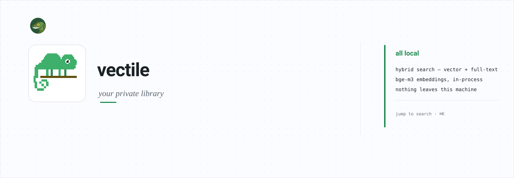
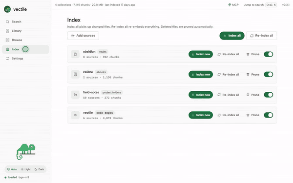
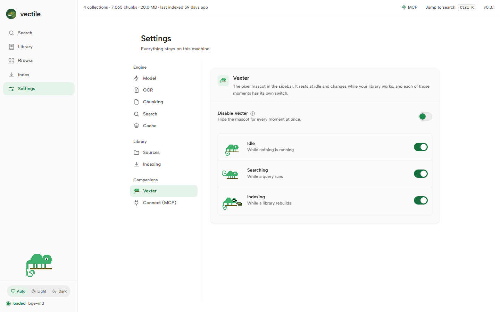

# vectile: your private library

A local RAG (Retrieval Augmented Generation) app for Windows, macOS, and Linux. It indexes your notes, books, and code into one SQLite database with hybrid vector + full-text search (Reciprocal Rank Fusion), so you can find things by meaning, not just exact words. Keyboard-first, and everything runs on your machine.

Inspired by Sebastian Hutter’s local-rag. No Ollama, no API keys: the embedding model runs in-process from a `.gguf` file you import or download from the built-in catalog.

  

  

## Features

- **Private:** indexing, parsing, embedding, search, and OCR run inside the app. Your documents and their text are never uploaded. See [network activity](#network-activity) for the three requests the app does make.
- **Search by meaning:** a blue-green deploy note matches “how do we ship changes safely” without using those words.
- **Index what you have:** Obsidian vaults, document folders (Markdown, PDF, DOCX, HTML, TXT, CSV, JSON, YAML, XML, SQL, shell scripts, XLSX, PPTX, Jupyter notebooks, EPUB), Calibre libraries, and code repositories with commit history.
- **Bring your own model:** import or download a `.gguf` from Settings.
- **Scanned PDFs:** install the Tesseract OCR plugin in Settings; photo pages become searchable.
- **Manage the library:** browse files and chunks, delete a source, selected chunks, or a whole library.
- **MCP server:** expose search, read, and collection tools to any local MCP client.

## Download

 - ⚠️ SmartScreen will block it · [how to fix](#first-run-notes) 
 
 
 

> Windows 10/11 · Linux (AppImage, deb) · macOS (universal) · **not code-signed, see [first-run notes](#first-run-notes)**

Normal Windows builds need AVX2; PCs from before ~2013 will not start. Use the [legacy installer](https://github.com/d3uceY/vectile/releases/latest/download/vectile-windows-amd64-legacy-installer.exe)
(or [legacy portable zip](https://github.com/d3uceY/vectile/releases/latest/download/vectile-windows-amd64-legacy.zip))
and pick **BGE Small EN v1.5 Q8_0** in Settings. Other quantized models are much slower without AVX2.

Build from source or package a release: [`CONTRIBUTING.md`](CONTRIBUTING.md).

### First-Run Notes

Not code-signed, so your OS may warn on first launch.

**Windows - SmartScreen**

1. Click **More info**
2. Click **Run anyway**

Or right-click the `.exe` -> **Properties** -> check **Unblock** -> **Apply**.

**macOS - Gatekeeper**

Right-click the app -> **Open** (once), or run `xattr -d com.apple.quarantine /path/to/vectile.app`.

**Linux**

The `.deb` pulls in GTK4, WebKitGTK 6.0, and `libgomp1`. The AppImage needs `chmod +x`.

## Screenshots

  

  

## Supported sources

| Source | Collection Type | What Gets Indexed |
|---|---|---|
| Obsidian | system | Vault files: `.md` notes with frontmatter, tags, and wikilinks |
| Project folders | project | Any folder of documents, each file parsed by its extension (`.md`, `.pdf`, `.docx`, `.html`, `.txt`, `.csv`, `.json`, `.yaml`, `.xml`, `.sql`, `.sh`, `.xlsx`, `.pptx`, `.ipynb`, `.epub`) |
| Code repositories | code | Git repos: tree-sitter splits each function and class into its own chunk (cAST split-then-merge); commit history is indexed as its own source |
| Calibre | system | Ebook metadata + content: title, author, tags, series, publisher, description, and EPUB/PDF text |

## Quick start

1. Launch vectile.
2. Get an embedding model: import one in Settings (copied to `models/`), download one from Settings → Model → **Get a model**, or drop a `.gguf` into `models/` yourself.
3. Add sources in Settings: Obsidian vaults, project folders, code repositories, Calibre libraries.
4. Open the Index view and index a collection, or everything at once. Unchanged files are skipped.
5. Press ⌘K / Ctrl K and search.

Deleted files drop out of the index automatically. Auto-reindex rebuilds on a timer; start-on-login opens the app with your session.

### Let an AI assistant search your library (MCP)

Settings → Connect starts a local MCP (Model Context Protocol) server at `127.0.0.1:31123`; it accepts local connections only.

Search, read, and list tools are always on; index and prune need **Allow write tools**.

Search returns a snippet and a chunk id, not a whole passage. The assistant pulls more with `vectile_get_chunk` or `vectile_read_source`, finds exact text with `vectile_grep`, and lists collection contents, so your whole library is never loaded.

Point any MCP client (Claude Desktop, Claude Code, …) at `http://127.0.0.1:31123/mcp`. Streamable HTTP is default; switch to SSE in Settings if a client needs the older transport. Settings shows server status, offered tools, and per-client setup.

## How search works

Two searches run per query.

- Full-text search matches exact words in an FTS5 index. Fast and literal.
- Vector search embeds the query and finds passages whose vectors point the same way, so "how do we ship changes safely" matches a blue-green deploy note.

A fast index picks candidates, then full vectors are compared and re-sorted by distance. Both result lists merge by rank, not score: Reciprocal Rank Fusion.

Filters: collection, source type, path, sender/author, date range. Top-k sets the result count.

Query embeddings are cached per model, so repeat searches skip the model; ranking is always fresh. The cache clears on reindex, prune, or model switch. Settings → Cache inspects and clears it.

## Configuration

`config.json`, in your per-user config folder:

- **Windows:** `%AppData%\vectile\config.json`
- **macOS:** `~/Library/Application Support/vectile/config.json`
- **Linux:** `~/.config/vectile/config.json`

| Key | Default | Description |
|---|---|---|
| embedding_model | bge-m3 | Embedding model name |
| active_model | (default model path) | Path to the active `.gguf` model |
| embedding_batch_size | 32 | Chunks per embedding call |
| chunk_size_tokens | 500 | Chunk size in whitespace-separated words |
| chunk_overlap_tokens | 50 | Overlap between chunks |
| obsidian_vaults | [] | Paths to Obsidian vaults |
| obsidian_exclude_folders | [] | Names to skip in vaults |
| project_exclude_folders | [node_modules] | Names to skip anywhere inside project folders |
| repository_exclude_folders | [] | Names to skip anywhere inside repositories |
| calibre_exclude_folders | [] | Names to skip inside Calibre libraries |
| calibre_libraries | [] | Paths to Calibre libraries |
| repositories | {} | Collection name to repo or directory paths; directories are scanned recursively for git repos |
| projects | {} | Collection name to document paths |
| disabled_collections | [] | Collection names to skip during indexing |
| skip_cloud_placeholders | true | Skip cloud-only placeholders (OneDrive, iCloud, Google, Synology), not download them |
| git_history_in_months | 6 | Months of commit history to index |
| git_commit_subject_blacklist | [] | Skip commits whose subject starts with any of these strings |
| search_defaults.top_k | 10 | Default number of search results |
| search_defaults.rrf_k | 60 | Reciprocal Rank Fusion parameter |
| search_defaults.vector_weight | 0.7 | Weight for vector similarity |
| search_defaults.fts_weight | 0.3 | Weight for full-text search |
| gui.auto_reindex | false | Enable periodic re-indexing |
| gui.auto_reindex_interval_minutes | 60 | Minutes between auto-reindex runs |
| gui.start_on_login | false | Launch at login |
| gui.mascot.show_idle | true | Show Vexter at rest between runs |
| gui.mascot.show_searching | true | Show Vexter in the sidebar while a query runs |
| gui.mascot.show_indexing | true | Show Vexter while a library rebuilds |
| mcp.enabled | false | Serve MCP tools to local assistants on launch |
| mcp.port | 31123 | Port the MCP server listens on (127.0.0.1 only) |
| mcp.allow_write | false | Let assistants call the index and prune tools |
| mcp.transport | streamable-http | MCP transport: `streamable-http` (`/mcp`) or `sse` (`/sse`) |
| ocr.enabled | true | Run OCR on PDF pages that come back with no text |
| ocr.languages | [eng] | Language codes; codes with no matching data are ignored |

## Network activity

Parsing, chunking, embedding, search, and OCR run in-process. Document text, chunks,
vectors, and library metadata never leave the machine. No server, account, or cloud sync.

Three outbound requests, and only these:

| When | What | Host |
|---|---|---|
| Every launch | The latest release tag, compared with your version to show an update badge. Sends no identifiers. No setting turns it off; blocking the host just means no update notice. | `api.github.com` |
| You press download in Settings → Model → **Get a model** | The `.gguf` you picked | `huggingface.co` (file bytes from its CDN, `*.cdn.hf.co`) |
| You install the Tesseract OCR plugin in Settings | The platform archive and the release `SHA256SUMS` it is verified against | `github.com` (assets from `release-assets.githubusercontent.com`) |

Both downloads happen only when you ask: import a model you already have, or skip the OCR plugin,
and nothing is fetched. Links open in your default browser, not in-app. **Settings → Connect**
starts a loopback-only MCP server, off by default.

No analytics, telemetry, crash reporting, or background uploads. The
[privacy page](https://d3ucey.github.io/vectile/docs/privacy) has the same detail.

## Tech stack

| Component | Choice | Notes |
|---|---|---|
| Language | Go 1.26+ | Wails v3 desktop app |
| UI | SolidJS + TypeScript + Vite | Tailwind CSS v4 |
| Database | SQLite (modernc.org/sqlite) + sqlite-vec + FTS5 | Pure Go, no cgo; single file |
| Embeddings | llama.go (llama.cpp) | In-process `.gguf`; bge-m3 by default; no Ollama |
| Code parsing | go-tree-sitter | cAST split-then-merge; one chunk per function, class, or method |
| PDF | go-pdfium (WASM/Wazero) | No cgo needed |
| DOCX | archive/zip + encoding/xml | Word document extraction (.docx, .dotx) |
| XLSX | excelize | Spreadsheets, one `## Sheet` section per worksheet |
| PPTX | archive/zip + encoding/xml | Slides, one `## Slide` section per slide |

## License

Apache License 2.0, copyright (c) 2026 d3uceY. See [`LICENSE`](LICENSE).

Bundled third-party code keeps its own license: vendored `third_party/llama-go` and the llama.cpp
sources it wraps are MIT.
